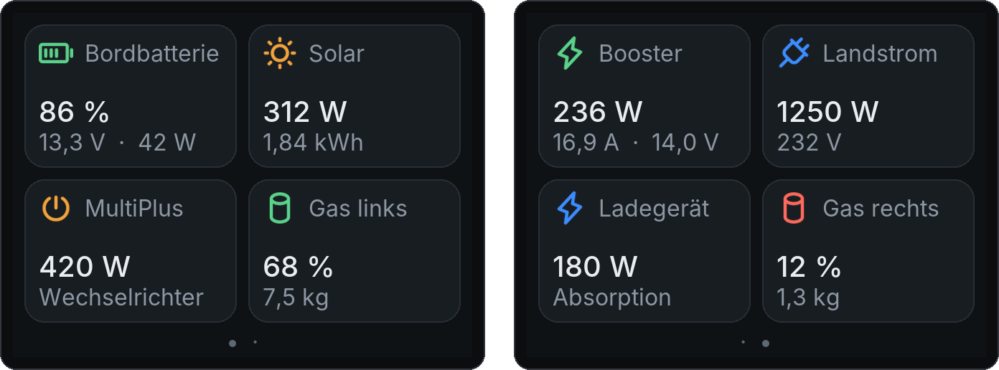

<p align="center">
  
</p>

<h1 align="center"> Simple Open Camper – Victron-Display </h1>

<h3 align="center">Victron und Gas im Camper auf einem 2,8"-Touch-Display – Cerbo GX per WLAN, Victron-Geräte, Truma LevelControl und Mopeka direkt per Bluetooth. Lokal, ohne Cloud.</h3>

<p align="center">
  
  
  
  
  
  
  
  
</p>

> Die abgespeckte Version von Simple Open Camper (S.O.C.) für alle,
> die **nur Victron und den Gasvorrat** sehen und bedienen wollen – auf einem Display für rund 15 €, ohne großes Panel.

<p align="center">
  
</p>

<p align="center"><b><a href="https://cyclemat.github.io/simply-open-camper-victron-beta/">⚡ Direkt im Browser aufspielen – Web-Flasher</a></b><br>
<sub>Deutsch oder Englisch · Chrome oder Edge am PC/Mac, Display per USB anschließen, Sprache wählen, „Installieren“ klicken.</sub><br>
<sub>🇬🇧 German or English · <a href="https://cyclemat.github.io/simply-open-camper-victron-beta/">web flasher</a>: connect via USB, pick the language, click “Install”.</sub></p>

---

## 🚧 Beta

Die Firmware läuft auf dem Board. **Noch nicht an jeder Anlage getestet** sind: Cerbo GX mit vielen Geräten,
MultiPlus-Steuerung (Strombegrenzung/Schalter) und Bluetooth-Ladegeräte. Rückmeldungen und Fotos willkommen!

## ✨ Was es kann

| | |
|---|---|
| 🔋 **Cerbo GX** (optional) | Batterie, Solar (Summe und jeder Laderegler einzeln), Netz/Landstrom, Ladegerät, Wechselrichter, DC-DC-Lader (Orion XS/Smart), Lichtmaschinenregler, DC-System – per MQTT im WLAN, der GX wird automatisch gefunden |
| 🔥 **Truma LevelControl** | Füllstand der Gasflaschen (%, kg, Akku des Sensors) per Bluetooth, bis zu 4 Sensoren |
| 💧 **SuperSense** *(Beta)* | Tankmodul „SSBT…“ (bis 4 Tanksensoren, auch SuperSense PRO mit Bluetooth) per Bluetooth – **ungetestet**, Rückmeldungen willkommen |
| 💧 **Simarine STRx** *(Beta)* | Tanksensoren STR1/STR2/STR3 per Bluetooth-Broadcast – offen oder mit dem Schlüssel aus der Simarine-App, **kein App-Key nötig** – **ungetestet** |
| 🔥 **Dieselheizung** *(Beta)* | Vevor/Hcalory (AirHeaterBLE), HeaterCC/AirHeater – an/aus, Stufe/Temperatur, Fehler; bedienbar in der Weboberfläche – **ungetestet** |
| 🧊 **Kühlbox** *(Beta)* | Alpicool, IceCube/Plug-in Festivals, Bodega u. a. – Ist/Soll je Zone; bedienbar in der Weboberfläche – **ungetestet** |
| 📡 **BTHome** *(Beta)* | Shelly BLU (Tür, Bewegung, Taster, H&T), Xiaomi mit pvvx-Firmware u. v. a. – Zustand bzw. Temperatur/Feuchte, auch verschlüsselt – **ungetestet** |
| 🌡️ **Ruuvi** *(Beta)* | Ruuvi Tag / Ruuvi Air per Bluetooth: Temperatur, Luftfeuchte, Luftdruck (Air: CO₂, Feinstaub) – **ungetestet** |
| 🌡️ **SwitchBot** *(Beta)* | Thermo-Hygrometer Meter, Meter Plus, Outdoor Meter per Bluetooth: Temperatur, Luftfeuchte, Batterie – **ungetestet** |
| ⚖️ **Senso4s** *(Beta)* | Gasflaschen-Waage Basic/Plus per Bluetooth – Füllstand in % und kg – **ungetestet** |
| 🛢️ **Mopeka** | Gasflaschen und Tanks per Bluetooth (Pro Check, Pro Plus, Pro Check Universal/H2O, Pro-200, TD40/TD200, Lippert BottleCheck, Check Standard/XL), bis zu 4 Sensoren |
| 📶 **Victron Bluetooth** | SmartSolar, SmartShunt/BMV, Orion/DC-DC, Blue Smart/Phoenix Smart Ladegeräte – „Instant Readout“, auch ganz ohne Cerbo |
| 🔋 **Akkus per Bluetooth** | Super B, Power Quarry/Shentec, Daly/Bulltron, JBD/Xiaoxiang, CS-BATTERIES (Beta), JK-BMS, LiTime/Redodo/PowerQueen, Renogy, Eco-Worthy, ANT, Vatrer: Ladezustand, Spannung, Strom, Temperatur, Zellen – nur lesen |
| ☀️ **Renogy per Bluetooth** | Laderegler (Rover/Wanderer/Adventurer mit BT-1/BT-2), DC-DC-Lader, Wechselrichter, Smart Shunt 300 – Solarleistung, Ladephase, Ertrag, Batterie – nur lesen |
| 🔌 **Power Stations** (ungetestet) | Bluetti, Allpowers, Anker SOLIX, EcoFlow: Ladezustand, Leistung rein/raus – AC- und DC-Ausgang schaltbar |
| 🎛️ **MultiPlus steuern** | Netzstrom-Begrenzung (− / +) und Schalter (Ein, Aus, Nur Laden, Nur Wechselrichter); eigenständige Ladegeräte: Begrenzung und Ein/Aus |
| 🧩 **Nur echte Werte** | Kacheln entstehen automatisch – nur für Geräte, die wirklich Werte liefern. Keine leeren Kacheln |
| 🚦 **Ampel-LED** | Die RGB-LED auf der Rückseite zeigt Batterie oder Gas: bis 10 % rot, bis 50 % orange, darüber grün |
| 👆 **Bedienung** | 4 oder 2 Kacheln pro Seite, Wischen zum Blättern, Antippen zum Bedienen, Dimmen nach Wunsch |
| 🌐 **Weboberfläche** | WLAN, Cerbo, Bluetooth-Geräte, Reihenfolge und Namen der Kacheln, Helligkeit, Firmware-Update |
| 🔒 **Sicher eingerichtet** | Einrichtungsseite öffnet sich von selbst (wie bei WLED), eigenes Zugangspasswort ist Pflicht |

## 🔭 Vorgeschmack: das große Panel

Dieses Display ist der kleine Bruder. Die **große Version von Simple Open Camper** ist ein 7"-Touch-Bedienteil
für den ganzen Camper – **sie erscheint in ein paar Tagen**. Ein kleiner Ausblick:

| | |
|---|---|
| 🖥️ **7"-Panels** | Waveshare ESP32-S3 7" und Elecrow CrowPanel ESP32-P4 7", dazu ein rundes 1,46"-Display mit Drehknopf |
| 🎨 **Eigene Oberfläche** | Kacheln, Seiten und Hintergründe im Browser per Drag & Drop gestalten |
| 💡 **Zigbee** | Lampen, Steckdosen, Taster, Bewegungsmelder – über Zigbee2MQTT oder direkt mit eingebautem Funkmodul |
| 🧩 **Regeln** | „Wenn … und falls … dann …“ mit grafischen Bausteinen, z. B. Bewegungslicht oder Dimmen per Taster |
| 🔥 **Heizung und Gas** | Truma (LevelControl, iNet X, CP Plus), Alde, Mopeka |
| 🔋 **Energie** | alles aus diesem Display – Victron, Cerbo GX, Akkus, Power Stations – und mehr |
| 🛰️ **Satelliten** | kleine ESP32 im Fahrzeug für Tanksonden, Temperaturen, Relais, Wasserwaage; dazu Zusatzdisplays wie dieses |
| 📡 **Lokal** | alles im eigenen WLAN, ohne Cloud – auf Wunsch mit eingebautem MQTT-Broker |

Wer hier mitliest, erfährt es zuerst. ⭐ Stern setzen oder das Repository beobachten.

## 🏠 Home Assistant *(in Arbeit)*

Das Display braucht kein Home Assistant. Geplant ist, dass es auch mit HA zusammenarbeitet:

- **Display → HA:** Das Display meldet seine **lokalen** Bluetooth-Geräte per MQTT-Discovery an Home Assistant –
  Gasflaschen (Truma LevelControl, Mopeka), Victron-Geräte per Bluetooth, Akkus und Power Stations, SuperSense.
- **HA → Display:** Werte und Schalter aus Home Assistant als Kacheln (über die HA-API mit Zugangstoken).

**Kein Daten-Kreislauf:** Gemeldet wird nur, was direkt am Display hängt. Was das Display schon per MQTT bekommt –
vor allem die Werte vom **Cerbo GX** (dafür hat HA eine eigene Victron-Integration) – wird **nicht** weitergemeldet.
Werte aus Home Assistant gehen nie zurück an HA, und Topics unter `homeassistant/` liest das Display nie als Eingang.

## 🛒 Hardware

Nur ein Board, keine Verkabelung: **ESP32-2432S028R** („Cheap Yellow Display“, CYD) – ESP32 mit 2,8"-Display
320×240 und resistivem Touch, Micro-USB. Strom über USB (5 V) aus dem Bordnetz, z. B. mit einem USB-Einbau-Lader.

👉 **Bezugsquelle:** [ESP32-2432S028R bei Amazon](https://link.amazon/B00jjmvuF)

| | |
|---|---|
| Chip | ESP32-WROOM-32, 4 MB Flash, kein PSRAM |
| Display | ILI9341 320×240 an HSPI (SCLK 14, MOSI 13, MISO 12, CS 15, DC 2), Hintergrundlicht GPIO 21 |
| Touch | XPT2046 (CLK 25, MOSI 32, MISO 39, CS 33, IRQ 36) – ein Finger (kein Multitouch) |
| RGB-LED | Rückseite, rot GPIO 4, grün GPIO 16, blau GPIO 17 (Low = an) – Ampel-Anzeige |
| Lichtsensor | LDR vorne neben dem Display, GPIO 34 – automatische Helligkeit |

### 🖥️ Großes Display: Waveshare 7" *(Beta)*

Das Victron-Display gibt es auch **groß**: auf dem **Waveshare ESP32-S3 Touch-LCD 7"** (1024×600, kapazitiver
Multitouch, 8 MB PSRAM). Gleiche Geräte wie beim kleinen Display, aber mit **Einstellungen direkt am Bildschirm**:

- WLAN wählen, Victron-Geräte und Akkus suchen, Cerbo GX finden, Gasflaschen einrichten – alles per Fingertipp
- **Victron** (Bluetooth und Cerbo GX), **Gas** (Truma LevelControl, Mopeka), **Akkus und Power Stations**,
  **SuperSense-Tankmodul** (Beta)
- **Shelly**-Schalter und -Dimmer über MQTT – auf Wunsch mit **eingebautem MQTT-Broker**, kein eigener Server nötig
- **Hobby-Wohnwagen/-Reisemobile** *(Beta)*: Lichter schalten, Bordbatterie, Wasser, Temperaturen, Heizung,
  Kühlschrank, Klima – über die **HobbyConnect-Box per Bluetooth** oder per **Kabel am LSG** (CI-BUS, RS232-TTL-Wandler,
  z. B. MAX3232 an der UART-Stiftleiste GPIO 15/16). Beides ab Werk aus: **Einstellungen → Fahrzeug**.
  Verdrahtung: Wandler **VCC an 3,3 V** (nicht 5 V), GND an GND, TXD des Wandlers an GPIO-RX, RXD an GPIO-TX;
  RS232-Seite an den Hobby-Kabelsatz „Bluetooth-Modul“. Kommt nichts an: RX/TX tauschen.
  **Niemals RS232 (±12 V) direkt an den ESP32!**
- Kacheln erscheinen von selbst, sobald ein Gerät Werte liefert; Feinschliff (Seiten, Größen, Hintergründe) im
  Browser-Editor des Displays
- vorerst **nur Deutsch** und **nur als fertige Firmware** (Web-Flasher: Gerät „Waveshare 7"“ wählen)

👉 **Bezugsquelle:** [Waveshare ESP32-S3 Touch-LCD 7" bei Amazon](https://www.amazon.de/dp/B0FDQXKFJ5)

## 🔑 Die zwei Passwörter

| | Wofür | Ab Werk | Ändern |
|---|---|---|---|
| **Zugangspasswort** | Anmelden an der Weboberfläche (Einstellungen ändern) | `panelsat` – **muss beim ersten Öffnen geändert werden** | Weboberfläche → „Zugangspasswort ändern“ |
| **WLAN-Passwort** | Verbinden mit dem Einrichtungs-WLAN „SOC-Victron-…“ | `panelsat`, eingeschaltet | Weboberfläche → Einrichtungs-WLAN: eigenes Passwort oder ganz ausschalten (offenes WLAN) |

Die beiden sind **unabhängig**: Wer das Zugangspasswort ändert, ändert das WLAN-Passwort nicht. Auch bei offenem
Einrichtungs-WLAN kann ohne Zugangspasswort niemand etwas einstellen.

## 🚀 Erste Einrichtung

1. **Firmware aufspielen** (siehe unten).
2. Am Handy oder Laptop mit dem WLAN **SOC-Victron-XXXXXX** verbinden – WLAN-Passwort ab Werk **`panelsat`**.
3. Die **Einstellungsseite öffnet sich von selbst** (wie bei einem Gast-WLAN). Falls nicht: im Browser
   **http://4.3.2.1/** öffnen. Meldet das Handy „kein Internet“, trotzdem verbunden bleiben.
4. **Eigenes Zugangspasswort vergeben:** Standardpasswort `panelsat` eingeben, neues Zugangspasswort
   (mindestens 8 Zeichen) zweimal eingeben. Damit meldest du dich künftig an der Weboberfläche an.
5. Optional unter **Einrichtungs-WLAN**: eigenes WLAN-Passwort setzen oder den Passwortschutz ausschalten.
6. **WLAN eintragen:** „Netze suchen“, Netz antippen, Passwort eingeben, Speichern. Das kann das eigene WLAN des
   Cerbo GX sein („venus-…“) oder das WLAN im Fahrzeug/zuhause, in dem der Cerbo hängt.
7. Danach erreichst du die Weboberfläche im WLAN unter **http://soc-victron-xxxxxx.local/** oder über die IP-Adresse:
   am Display von oben nach unten wischen (oder die Kachel „Einrichten“ antippen) – dann stehen Name, WLAN und
   Adresse groß auf dem Bildschirm.

Ohne WLAN-Verbindung öffnet das Display nach 30 Sekunden wieder sein Einrichtungs-WLAN.

### Cerbo GX verbinden (optional)

1. Am Cerbo GX: *Einstellungen → Dienste → MQTT im LAN (Klartext)* einschalten.
2. In der Weboberfläche bei **Cerbo GX**: „Cerbo GX verwenden“ anhaken und speichern.
3. „Automatisch suchen“ findet den GX unter 172.24.24.1 (eigenes WLAN des Cerbo), am Router (Gateway) oder als
   `venus.local` / `einstein.local`. Alternativ die Adresse von Hand eintragen.
4. Alles, was der GX liefert, erscheint automatisch als Kachel.

Ab Werk ist der Cerbo **aus** – wer nur Bluetooth-Geräte hat, braucht ihn nicht.

### Victron-Geräte per Bluetooth

1. In der Weboberfläche bei **Victron per Bluetooth**: „Geräte suchen“ (3 Minuten).
2. Gefundenes Gerät „Hinzufügen“ und den **Schlüssel** eintragen. Den findest du in VictronConnect:
   *Gerät → Einstellungen (Zahnrad) → ⋮ → Produktinfo → Instant Readout → Details anzeigen → Verschlüsselungsschlüssel*.
3. Sobald das erste Paket ankommt, erscheint die Kachel.

Bluetooth startet erst, wenn ein Gerät eingerichtet ist oder gesucht wird.

### Truma LevelControl (Gasflaschen)

1. **Truma-App schließen** – der Sensor spricht immer nur mit einem Gerät.
2. In der Weboberfläche bei **Truma LevelControl**: „Sensoren suchen“, dann am Sensor kurz die Taste drücken
   (LED blinkt).
3. Gefundenen Sensor „Hinzufügen“ und benennen, z. B. „Flasche links“.
4. Gemessen wird automatisch alle 10 Minuten (einstellbar 2–240) oder per „Jetzt messen“.
   Die Kachel erscheint mit der ersten Messung.

### Mopeka (Gasflaschen und Tanks)

1. In der Weboberfläche bei **Mopeka**: „Sensoren suchen“, dann am Sensor die Sync-Taste drücken.
2. Gefundenen Sensor „Hinzufügen“ und benennen, dann **Flasche/Tank** wählen (Vorgabe oder „Eigene Maße“:
   Füllhöhe leer/voll in mm und Inhalt).
3. Die Sensoren senden ihre Werte von selbst – keine Kopplung, die Mopeka-App bleibt nutzbar.
   Die Kachel erscheint mit dem ersten Messwert.

**Senso4s** *(Beta, ungetestet)*: Die Gasflaschen-Waage Basic/Plus wird genauso bei **Mopeka** gesucht und erscheint
als „Senso4s Basic“ bzw. „Senso4s Plus“. Flasche und Nullabgleich vorher in der Senso4s-App einrichten, hier die
Flaschengröße wählen (für kg). Sie meldet sich alle 15 Minuten; Hinweise wie „Nullabgleich nötig“ oder „Batterien
leer“ stehen im Status.

### SuperSense (Beta, ungetestet)

- **Tankmodul** („SSBT…“): erscheint bei **Sensoren suchen** als „SuperSense Tankmodul (Beta)“. Hinzufügen – je
  angeschlossenem Tanksensor eine Kachel mit Füllstand (ohne Kalibrierung: Rohwert 2475 = voll) und Temperatur.
  Die SuperSense-App dabei schließen.

Das Protokoll ist nachgebaut, nicht vom Hersteller dokumentiert. Bitte meldet, ob die Werte stimmen (Issue).

### Simarine STRx-Tanksensoren (Beta, ungetestet)

Die Simarine-Tanksensoren **STR1** (analog), **STR2** (NMEA 2000) und **STR3** (RV-C) können ihren Füllstand per
Bluetooth senden („Broadcast“). Das Display hört nur mit – keine Kopplung, **kein App-Key nötig**.

1. In der App **Simarine Connect** den Tank einrichten (Höhe, Inhalt, Tankart, Kalibrierung).
2. Je Sensor **Device Management → Broadcast Settings → Broadcast Mode** einschalten – **ab Werk ist er aus**.
3. Modus wählen:
   - **Open** – Füllstand, Inhalt und Tankart für jeden lesbar. Nichts weiter einzutragen; am einfachsten zum Ausprobieren.
   - **Low / Medium / High Security** – Füllstand verschlüsselt. Jeder Sensor hat **seinen eigenen Schlüssel**: in der
     App **Show Encryption Key** antippen und die **32 Zeichen** beim Hinzufügen bzw. später im Feld **PIN / Passwort**
     eintragen. Der Schlüssel ist nicht die 4-stellige Geräte-PIN der App. Bei Medium/High sendet der Sensor Inhalt und
     Tankart nicht mit – dann zeigt das Display nur Prozent.
4. **Simarine-App schließen bzw. vom Sensor trennen** – solange ein Handy verbunden ist, sendet der Sensor nicht.
5. In der Weboberfläche bei **Sensoren per Bluetooth** „Sensoren suchen“. Der Sensor erscheint als „Simarine STRx“. Hinzufügen –
   Kachel mit Füllstand, im Detail Inhalt in Litern, Tankart und ob der Funk offen oder verschlüsselt ist.

Fehlt der Wert, steht der Grund im Status: Broadcast aus, Schlüssel fehlt, Schlüssel passt nicht. Wird der Schlüssel in
der Simarine-App neu erzeugt, den neuen eintragen. Nicht als einzige Messung für sicherheitskritische Füllstände nutzen.

### Ruuvi und SwitchBot (Beta, ungetestet)

Ruuvi Tag und Ruuvi Air senden ihre Werte offen per Bluetooth – keine Kopplung, kein Passwort, die Ruuvi-App darf
offen bleiben. Bei **Sensoren suchen** erscheint der Sensor als „Ruuvi“, hinzufügen, fertig: Kachel mit Temperatur und
Luftfeuchte (Ruuvi Air zusätzlich CO₂), im Detail auch Luftdruck, Feinstaub und Batterie.

**Dieselheizung und Kühlbox** *(Beta, ungetestet)*: werden bei „Heizung/Kühlbox suchen“ (eigene Karte) als „Dieselheizung“ bzw. „Kühlbox“
gefunden. Hersteller-App vorher schließen; Kühlbox beim ersten Mal ggf. Settings-Taste an der Box drücken. In der
Akku-Karte gibt es dann Knöpfe für **Ein/Aus** und **− / +** (Heizung: Stufe bzw. Temperatur, Kühlbox: Soll). Bei einem
Heizungsfehler (E…) ist nur noch Ausschalten möglich.

**BTHome** (Shelly BLU, Xiaomi mit pvvx-Firmware …) erscheint bei „Sensoren suchen“ als „BTHome“. Kachel mit
Temperatur/Feuchte bzw. dem Zustand („Tür offen“, „Bewegung“). Verschlüsselte Geräte: Schlüssel (32 Zeichen) ins
Feld **PIN / Passwort**.

Genauso die **SwitchBot**-Thermo-Hygrometer (Meter, Meter Plus, Outdoor Meter): erscheinen als „SwitchBot Meter“,
Kachel mit Temperatur und Luftfeuchte, im Detail der Batteriestand. Ein SwitchBot-Hub ist nicht nötig.

### Akkus und Power Stations per Bluetooth

1. **App des Herstellers schließen** (z. B. „Be in Charge“, „Power Quarry“, „BullTron“, „Xiaoxiang“, „JK BMS“, „LiTime“) – der Akku spricht nur mit einem Gerät.
2. In der Weboberfläche bei **Akkus und Power Stations per Bluetooth**: „Akkus suchen“ (1 Minute).
3. Gefundenen Akku „Hinzufügen“ und benennen, z. B. „Bordbatterie“.
4. Das Display verbindet sich und bleibt verbunden. Super B bleibt verbunden und meldet seine Werte selbst. Alle anderen werden
   alle 20 Sekunden kurz verbunden und abgefragt (Power Quarry: Ladezustand einmal pro Minute). Die Kachel erscheint mit den ersten Werten.

**Zellspannungen:** Bei vielen Akkus sieht man jetzt auch jede einzelne Zelle – JBD/Xiaoxiang, CS-BATTERIES, JK-BMS,
Daly/Bulltron, ANT, Eco-Worthy, Renogy, Vatrer und Power Quarry/Shentec. Kachel **2 s drücken**: Übersicht mit
Kapazität, Gesundheit, Zellen min–max mit Differenz (Δ) und darunter jede Zelle einzeln (wischen zum Blättern). In
der Weboberfläche stehen die Zellen in der Akku-Karte.

Das Display liest nur – es schaltet am Akku nichts und ändert keine Einstellungen. Klappt die Verbindung nicht,
steht unter „Protokoll“ in der Akku-Karte, woran es hängt.

**PIN oder Passwort:** Verlangt ein Akku beim Koppeln eine PIN (z. B. Super B) oder ist in seiner App ein Passwort
gesetzt, beim Hinzufügen „Ja“ wählen bzw. später im Feld **PIN / Passwort** eintragen. **CS-BATTERIES** *(Beta,
ungetestet)*: Die Anmeldung der CS-App übernimmt das Display selbst – nur ein eigenes Passwort muss eingetragen werden.

**Power Stations** (Bluetti, Allpowers, Anker SOLIX, EcoFlow – ungetestet) richtest du genauso ein. In der Karte
erscheinen dann Knöpfe für den **AC- und DC-Ausgang**. **EcoFlow** braucht einmalig die Benutzer-ID deines Kontos:
in der Karte E-Mail und Passwort eintragen, das Display holt sie über das Internet (Passwort wird nicht gespeichert),
danach läuft alles lokal per Bluetooth ohne Internet.

### Ampel-LED auf der Rückseite

Die farbige LED auf der Rückseite des Boards zeigt einen Füllstand auf einen Blick:

| Füllstand | LED |
|---|---|
| bis 10 % | 🔴 rot |
| 11–50 % | 🟠 orange |
| über 50 % | 🟢 grün |
| kein Messwert | aus |

In der Weboberfläche unter **Ampel-LED** wählst du, was sie zeigt: **Automatisch** (Ladezustand der Batterie,
ohne Batteriemonitor das Gas), **Batterie** (SmartShunt/BMV per Bluetooth, Cerbo GX oder Akku per Bluetooth), **Gas** (Truma
LevelControl oder Mopeka, die leerste Flasche) oder **Aus**.

### MultiPlus / Ladegerät bedienen

Kachel **Netz**, **Ladegerät** oder **Wechselrichter** **2 Sekunden gedrückt halten** → Fenster mit

- **Netzstrom-Begrenzung**: − / + in ganzen Ampere (wird kurz nach dem letzten Tippen an den GX geschickt),
- **Schalter**: Ein, Aus, Nur Laden, Nur Wechselrichter (beim eigenständigen Ladegerät: Ein/Aus).

Erscheint nur, wenn der GX den Wert liefert **und** als einstellbar meldet (z. B. nicht, wenn ein Digital
Multi Control die Begrenzung festlegt). Dasselbe gibt es in der Weboberfläche beim Cerbo.

## 👆 Bedienung am Display

| Geste | Wirkung |
|---|---|
| Wischen links/rechts | nächste/vorige Seite (Punkte unten zeigen die Seite) |
| Kachel 2 s gedrückt halten | MultiPlus/Ladegerät bedienen (wo möglich), Akku: Übersicht aller Werte |
| Von oben nach unten wischen | Name, WLAN und Adresse der Weboberfläche groß anzeigen (antippen schließt) |
| Berühren nach dem Dimmen | weckt nur auf |
| Beim Einschalten **2 s** drücken, dann loslassen | **Touch kalibrieren** (vier Pfeilspitzen antippen) |
| Beim Einschalten **10 s** drücken | **Zugangs- und WLAN-Passwort** auf `panelsat` zurücksetzen |

Welche Kacheln in welcher Reihenfolge und unter welchem Namen erscheinen, wie viele pro Seite, Helligkeit und
Dimmzeit stellst du in der Weboberfläche unter **Display** ein. Dort gibt es auch „Touch kalibrieren“.

**Helligkeit automatisch:** Der Lichtsensor vorne neben dem Display schaltet zwischen der normalen Helligkeit und
der „Helligkeit bei Dunkelheit“ um (ab Werk an). Nachts wird auch die Ampel-LED gedimmt. Unter **Display** steht der
aktuelle Messwert (größer = dunkler): Raum abdunkeln, Wert ablesen und etwas darunter als „Dunkel ab Messwert“
eintragen. Der Sensor ist auf diesen Boards eher grob – er unterscheidet hell und dunkel, mehr nicht.

## 🆘 Notfall: Einrichtungs-WLAN erzwingen

Auch ohne Touch und ohne Passwort kommst du immer wieder ran – über **schnelles Aus- und Einschalten**
(jeweils kürzer als 10 Sekunden laufen lassen, auch per Reset-Taste):

| | |
|---|---|
| **3×** hintereinander | Einrichtungs-WLAN geht sofort auf und bleibt bis zum nächsten Neustart an (WLAN-Daten bleiben) |
| **5×** hintereinander | WLAN-Verbindung gelöscht, Zugangs- und WLAN-Passwort auf Werkseinstellung (`panelsat`) – Geräte und Kacheln bleiben |

## 🔧 Firmware aufspielen

**Am einfachsten:** im Browser mit dem **[⚡ Web-Flasher](https://cyclemat.github.io/simply-open-camper-victron-beta/)**
(Chrome oder Edge am PC/Mac) – Display per USB anschließen, **Gerät** (CYD 2,8" oder Waveshare 7") und **Sprache**
wählen, „Installieren“ klicken, fertig. Löscht die Einstellungen, also nur für neue Displays; eingerichtete Displays über ihre Weboberfläche aktualisieren.

**Fertige Dateien** liegen im Ordner [`release/`](release/) dieses Repositorys – immer die neueste Fassung, die vorige
in `release/vorher/`:

- `release/victron-display-cyd.bin` – für das **erste Aufspielen per USB**, komplett (Bootloader, Partitionen,
  Firmware und der kleine Updater) an Adresse **0x0**, z. B. mit
  `esptool.py --chip esp32 write_flash 0x0 victron-display-cyd.bin` oder einem ESP-Web-Flasher.
  **Achtung:** löscht dabei die Einstellungen (WLAN, Geräte, Kacheln). Ein schon eingerichtetes Display per USB
  aktualisieren, ohne die Einstellungen zu verlieren: `esptool.py --chip esp32 write_flash 0x10000 ota/victron-display-cyd.bin`,
- `release/ota/victron-display-cyd.bin` – für spätere **Updates über die Weboberfläche** (**Firmware → Hochladen**).
- Englische Fassung: dieselben Dateien mit `-en` (`release/victron-display-cyd-en.bin`, `release/ota/victron-display-cyd-en.bin`).

**Selbst bauen** mit [PlatformIO](https://platformio.org/) (VS Code):

```
pio run -t upload                      # Deutsch
pio run -e cyd-victron-en -t upload    # Englisch
```

Englisch: Display-Texte stehen in `src/i18n/en.h`, die Weboberfläche entsteht beim Bauen aus `src/vicdisp/vd_page.h`
und dem Wörterbuch `tools/i18n/vicdisp_en.json` (`tools/i18n_page.py`).

Der erste Build lädt Framework und Werkzeuge in `.pio/packages` (eigener Paketordner) und dauert entsprechend.
Eigenes Startbild: `splash_cyd.jpg` (320×240, JPEG „baseline“) in den Projektordner legen.

## ❓ Häufige Fragen

- **Seite öffnet sich nicht von selbst?** Am Handy das WLAN „SOC-Victron-…“ einmal *vergessen* und neu
  verbinden, dann http://4.3.2.1/ im Browser öffnen. Mobile Daten kurz ausschalten hilft manchen Handys.
- **Touch trifft daneben?** Touch kalibrieren (beim Einschalten 2 s drücken oder in der Weboberfläche).
- **Kachel fehlt?** Es erscheinen nur Geräte mit echten Werten. Victron-Bluetooth: Schlüssel prüfen (Status in der
  Weboberfläche). Cerbo: MQTT im LAN am GX an? „Cerbo GX verwenden“ angehakt? LevelControl: Truma-App zu?
  „Jetzt messen“ drücken.
- **Cerbo trennt ab und zu?** Meist schwaches WLAN – näher an den GX oder dessen eigenes WLAN verwenden.

## 📝 Änderungen

Was sich von Version zu Version geändert hat: **[CHANGELOG.md](CHANGELOG.md)**

## 🔗 Fehler und Wünsche

Bitte hier als [Issue](../../issues) melden. Der Code wird automatisch aktualisiert – Pull Requests werden deshalb
nicht direkt übernommen, sondern von Hand eingearbeitet (siehe [CONTRIBUTING.md](CONTRIBUTING.md)).

---

<details>
<summary>🇬🇧 English (short)</summary>

Lean firmware for the ESP32-2432S028R "Cheap Yellow Display" ([buy on Amazon](https://link.amazon/B00jjmvuF)): shows all Victron values and gas levels as tiles –
from a Cerbo GX via WiFi (MQTT on LAN, auto-discovery, optional), from Victron devices via Bluetooth (Instant
Readout) and from Truma LevelControl and Mopeka gas/tank sensors via Bluetooth; SuperSense and Simarine STRx tank sensors (open or with the sensor's own key, no app key needed), Ruuvi and SwitchBot climate sensors as untested beta. Tap a
tile to set the MultiPlus input current limit and mode. Setup: join WiFi `SOC-Victron-XXXXXX` (default password
`panelsat`), the setup page opens automatically (captive portal, http://4.3.2.1/), set your own access password
(web UI), then your WiFi. The setup WiFi password is separate (default `panelsat`, can be changed or switched off).
Emergency: power-cycle 3× quickly = setup WiFi on, 5× = reset WiFi and both passwords. Build with
PlatformIO: `pio run -t upload` (German) or `pio run -e cyd-victron-en -t upload` (English). Beta.

**Home Assistant (in progress):** the display will report its **local** Bluetooth devices to HA via MQTT discovery
and show HA values as tiles. No data loop: values it already receives via MQTT (Cerbo GX) are not reported, values
from HA never go back to HA, topics below `homeassistant/` are never read as input.

**Big display (beta):** the Victron display also runs on the **Waveshare ESP32-S3 Touch LCD 7"**
([Amazon](https://www.amazon.de/dp/B0FDQXKFJ5)) with settings right on the screen, Shelly support, a built-in
MQTT broker and Hobby caravans/motorhomes (HobbyConnect box via Bluetooth or CI-BUS cable, beta) – German only for now, ready-made firmware via the web flasher (choose “Waveshare 7"”).

**Coming soon:** the big brother – a 7" touch panel for the whole camper (Zigbee lights and switches, rules with
graphical blocks, Truma/Alde heating, everything from this display and more) will be released in a few days.

**Install from the browser:** [web flasher](https://cyclemat.github.io/simply-open-camper-victron-beta/) – choose **English**,
click “Install”. Ready-made files: `release/victron-display-cyd-en.bin` (first install via USB, address 0x0, erases
settings) and `release/ota/victron-display-cyd-en.bin` (update via the web interface).

If it helps you: **[☕ support CycleMat on PayPal](https://paypal.me/cyclemat)**
</details>

## ❤ Support & Spenden

Das Projekt entsteht in der Freizeit. Wenn es dir hilft, freue ich mich über einen Kaffee:

**[☕ PayPal – CycleMat unterstützen](https://paypal.me/cyclemat)**

Kein Druck, keine Werbung, keine Bezahlschranke ❤

## 📄 Lizenz

[PolyForm Noncommercial 1.0.0](LICENSE) – nur nicht-kommerzielle Nutzung; kommerzielle Lizenzen (Verkauf der Firmware
oder von Geräten damit, gewerblicher Einbau) vergibt nur der Urheber. Teile in `src/third_party/` stehen unter eigenen
Lizenzen (siehe [dort](src/third_party/README.md)). Victron Energy, Cerbo GX, MultiPlus, SmartSolar usw. sind Marken der
Victron Energy B.V., Truma und LevelControl Marken der Truma Gerätetechnik GmbH & Co. KG, Mopeka Marke der Mopeka Products LLC, SuperSense Marke der comworks core GmbH; dieses Projekt ist kein
offizielles Produkt dieser Firmen und steht in keiner Verbindung zu ihnen.
